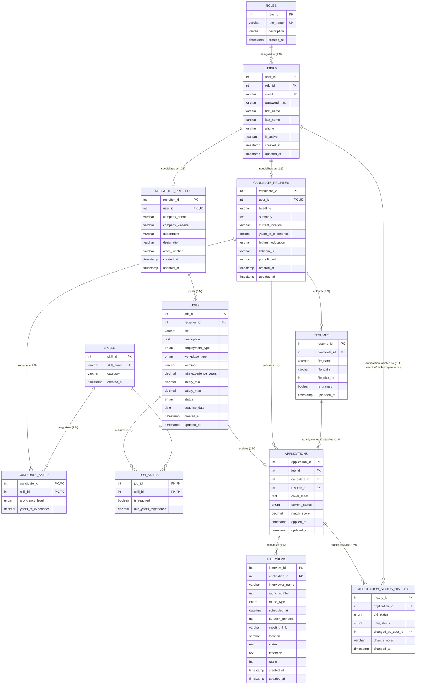

# Job Portal and Application Tracking System (ATS)
## Phase 1: System Architecture & Database Design Specification

---

### 1. Executive Summary & Project Architecture

The **Job Portal and Application Tracking System (ATS)** is an end-to-end, enterprise-grade university DBMS capstone project built on the **MySQL 8.0** relational database engine, a **Python Flask** web backend, and a modern responsive interface using **HTML5, CSS3, Bootstrap 5, and JavaScript**.

The database name is strictly and consistently defined as **`job_portal_ats`** across all configuration files, connection scripts, and documentation.

#### 1.1 Five Sequential Project Phases
1. **Phase 1: Data Modelling & Schema Definition (Current Phase)**
   - Conceptual and logical ER modeling with cardinalities and constraints.
   - Strict 3NF normalization.
   - Safe, non-destructive DDL implementation (`sql/schema.sql`) using `CREATE DATABASE IF NOT EXISTS job_portal_ats` and `CREATE TABLE IF NOT EXISTS` without any destructive `DROP` statements.
   - Candidate resume ownership enforcement via composite referential integrity.
   - Definition of the audit table (`application_status_history`) and relational integrity structure.
   - *Phase Gate*: Once approved, the schema remains completely unchanged throughout all subsequent phases.
2. **Phase 2: Procedural Implementation**
   - Stored Procedures (`sql/procedures.sql`): Multi-table transactional workflows (e.g. `sp_apply_job`, `sp_schedule_interview`).
   - Stored Functions (`sql/functions.sql`): Algorithmic calculations (e.g. `fn_calculate_match_score`).
   - Triggers (`sql/triggers.sql`): Automated lifecycle auditing (`application_status_history`), interview scheduling clash checks.
   - Seed Sample Data (`sql/sample_data.sql`): Realistic test datasets across all 12 tables.
3. **Phase 3: Query & Report Development**
   - Analytical Queries & Aggregation Views (`sql/reports.sql`): Recruitment funnel drop-off, time-to-hire metrics, high-demand skills matrix, interviewer rating performance.
4. **Phase 4: Security, RBAC & Testing**
   - Role-Based Access Control (Admin, Recruiter, Candidate).
   - Password hashing with Bcrypt, SQL injection defense via parameterized queries, session protection.
   - Unit and integration tests for transactions and integrity rules.
5. **Phase 5: Integration & Web User Interface**
   - Connected Python Flask web application.
   - Responsive templates and role-tailored dashboards.
   - Client-side validation and interactive charts.

---

### 2. Entity-Relationship (ER) Diagram



> **Relationship Note on `USERS` $\rightarrow$ `APPLICATION_STATUS_HISTORY`**:  
> One `USER` can be associated with zero or many status history records, while each history record may have zero or one `changed_by_user_id` because automated system transitions and background triggers can have `changed_by_user_id = NULL`.

---

### 3. Relational Schema (Formal Notation)

Primary keys are **bolded**, foreign keys are marked with `(FK)`:

1. **`roles`** (**`role_id`**, `role_name`, `description`, `created_at`)
   - *Candidate Keys*: `role_id`, `role_name`

2. **`users`** (**`user_id`**, `role_id`*(FK)*, `email`, `password_hash`, `first_name`, `last_name`, `phone`, `is_active`, `created_at`, `updated_at`)
   - *Candidate Keys*: `user_id`, `email`
   - *Foreign Key*: `role_id` $\rightarrow$ `roles(role_id)`

3. **`candidate_profiles`** (**`candidate_id`**, `user_id`*(FK, UK)*, `headline`, `summary`, `current_location`, `years_of_experience`, `highest_education`, `linkedin_url`, `portfolio_url`, `created_at`, `updated_at`)
   - *Candidate Keys*: `candidate_id`, `user_id`
   - *Foreign Key*: `user_id` $\rightarrow$ `users(user_id)` [1:1, UNIQUE]

4. **`recruiter_profiles`** (**`recruiter_id`**, `user_id`*(FK, UK)*, `company_name`, `company_website`, `department`, `designation`, `office_location`, `created_at`, `updated_at`)
   - *Candidate Keys*: `recruiter_id`, `user_id`
   - *Foreign Key*: `user_id` $\rightarrow$ `users(user_id)` [1:1, UNIQUE]

5. **`skills`** (**`skill_id`**, `skill_name`, `category`, `created_at`)
   - *Candidate Keys*: `skill_id`, `skill_name`

6. **`candidate_skills`** (**`candidate_id`***(FK)*, **`skill_id`***(FK)*, `proficiency_level`, `years_of_experience`)
   - *Composite Primary Key*: (`candidate_id`, `skill_id`)
   - *Foreign Keys*: `candidate_id` $\rightarrow$ `candidate_profiles(candidate_id)`, `skill_id` $\rightarrow$ `skills(skill_id)`

7. **`jobs`** (**`job_id`**, `recruiter_id`*(FK)*, `title`, `description`, `employment_type`, `workplace_type`, `location`, `min_experience_years`, `salary_min`, `salary_max`, `status`, `deadline_date`, `created_at`, `updated_at`)
   - *Foreign Key*: `recruiter_id` $\rightarrow$ `recruiter_profiles(recruiter_id)`

8. **`job_skills`** (**`job_id`***(FK)*, **`skill_id`***(FK)*, `is_required`, `min_years_experience`)
   - *Composite Primary Key*: (`job_id`, `skill_id`)
   - *Foreign Keys*: `job_id` $\rightarrow$ `jobs(job_id)`, `skill_id` $\rightarrow$ `skills(skill_id)`

9. **`resumes`** (**`resume_id`**, `candidate_id`*(FK)*, `file_name`, `file_path`, `file_size_kb`, `is_primary`, `uploaded_at`)
   - *Candidate Keys*: `resume_id`, (`resume_id`, `candidate_id`)
   - *Foreign Key*: `candidate_id` $\rightarrow$ `candidate_profiles(candidate_id)`

10. **`applications`** (**`application_id`**, `job_id`*(FK)*, `candidate_id`*(FK)*, `resume_id`*(FK)*, `cover_letter`, `current_status`, `match_score`, `applied_at`, `updated_at`)
    - *Candidate Keys / Unique Constraints*: `application_id`, (`job_id`, `candidate_id`)
    - *Foreign Keys*:
      - `job_id` $\rightarrow$ `jobs(job_id)`
      - `candidate_id` $\rightarrow$ `candidate_profiles(candidate_id)`
      - `(resume_id, candidate_id)` $\rightarrow$ `resumes(resume_id, candidate_id)` *(Guarantees strict candidate resume ownership)*

11. **`interviews`** (**`interview_id`**, `application_id`*(FK)*, `interviewer_name`, `round_number`, `round_type`, `scheduled_at`, `duration_minutes`, `meeting_link`, `location`, `status`, `feedback`, `rating`, `created_at`, `updated_at`)
    - *Foreign Key*: `application_id` $\rightarrow$ `applications(application_id)`

12. **`application_status_history`** (**`history_id`**, `application_id`*(FK)*, `old_status`, `new_status`, `changed_by_user_id`*(FK)*, `change_notes`, `changed_at`)
    - *Foreign Keys*:
      - `application_id` $\rightarrow$ `applications(application_id)`
      - `changed_by_user_id` $\rightarrow$ `users(user_id)`

---

### 4. Data Dictionary

#### 4.1 `roles`
| Field Name | Type | Constraints | Default | Description |
|---|---|---|---|---|
| `role_id` | INT | PK, AUTO_INCREMENT | None | Unique identifier for system role |
| `role_name` | VARCHAR(50) | UNIQUE, NOT NULL | None | Name of role ('ADMIN', 'RECRUITER', 'CANDIDATE') |
| `description` | VARCHAR(255) | NULL | NULL | Role permissions summary |
| `created_at` | TIMESTAMP | NOT NULL | CURRENT_TIMESTAMP | Role record creation timestamp |

#### 4.2 `users`
| Field Name | Type | Constraints | Default | Description |
|---|---|---|---|---|
| `user_id` | INT | PK, AUTO_INCREMENT | None | Unique system user ID |
| `role_id` | INT | FK -> `roles(role_id)`, NOT NULL | None | Assigned security role |
| `email` | VARCHAR(255) | UNIQUE, NOT NULL | None | User authentication email |
| `password_hash` | VARCHAR(255) | NOT NULL | None | Securely hashed password (Bcrypt) |
| `first_name` | VARCHAR(100) | NOT NULL | None | User's legal first name |
| `last_name` | VARCHAR(100) | NOT NULL | None | User's legal last name |
| `phone` | VARCHAR(20) | NULL | NULL | Contact phone number |
| `is_active` | BOOLEAN | NOT NULL | TRUE | Account active/disabled flag |
| `created_at` | TIMESTAMP | NOT NULL | CURRENT_TIMESTAMP | Registration timestamp |
| `updated_at` | TIMESTAMP | NOT NULL | CURRENT_TIMESTAMP ON UPDATE | Last account modification timestamp |

#### 4.3 `candidate_profiles`
| Field Name | Type | Constraints | Default | Description |
|---|---|---|---|---|
| `candidate_id` | INT | PK, AUTO_INCREMENT | None | Unique candidate profile ID |
| `user_id` | INT | FK -> `users(user_id)`, UNIQUE, NOT NULL | None | Associated user login ID (1:1) |
| `headline` | VARCHAR(255) | NULL | NULL | Professional tagline |
| `summary` | TEXT | NULL | NULL | Biography and career summary |
| `current_location` | VARCHAR(150) | NULL | NULL | City, State, Country |
| `years_of_experience` | DECIMAL(4,1) | NOT NULL, CHECK (>= 0.0) | 0.0 | Total professional experience in years |
| `highest_education` | VARCHAR(100) | NULL | NULL | Highest degree earned |
| `linkedin_url` | VARCHAR(255) | NULL | NULL | External LinkedIn profile URL |
| `portfolio_url` | VARCHAR(255) | NULL | NULL | Personal website / GitHub portfolio URL |
| `created_at` | TIMESTAMP | NOT NULL | CURRENT_TIMESTAMP | Creation timestamp |
| `updated_at` | TIMESTAMP | NOT NULL | CURRENT_TIMESTAMP ON UPDATE | Profile update timestamp |

#### 4.4 `recruiter_profiles`
| Field Name | Type | Constraints | Default | Description |
|---|---|---|---|---|
| `recruiter_id` | INT | PK, AUTO_INCREMENT | None | Unique recruiter profile ID |
| `user_id` | INT | FK -> `users(user_id)`, UNIQUE, NOT NULL | None | Associated user login ID (1:1) |
| `company_name` | VARCHAR(150) | NOT NULL | None | Employing organization / company |
| `company_website` | VARCHAR(255) | NULL | NULL | Official corporate website |
| `department` | VARCHAR(100) | NULL | NULL | Department (e.g., Talent Acquisition) |
| `designation` | VARCHAR(100) | NULL | NULL | Recruiter job title |
| `office_location` | VARCHAR(150) | NULL | NULL | Office city / headquarters |
| `created_at` | TIMESTAMP | NOT NULL | CURRENT_TIMESTAMP | Creation timestamp |
| `updated_at` | TIMESTAMP | NOT NULL | CURRENT_TIMESTAMP ON UPDATE | Profile update timestamp |

#### 4.5 `skills`
| Field Name | Type | Constraints | Default | Description |
|---|---|---|---|---|
| `skill_id` | INT | PK, AUTO_INCREMENT | None | Unique skill master ID |
| `skill_name` | VARCHAR(100) | UNIQUE, NOT NULL | None | Skill title (e.g. 'Python', 'MySQL', 'Docker') |
| `category` | VARCHAR(50) | NOT NULL | None | Category ('Programming', 'Database', etc.) |
| `created_at` | TIMESTAMP | NOT NULL | CURRENT_TIMESTAMP | Record creation timestamp |

#### 4.6 `candidate_skills`
| Field Name | Type | Constraints | Default | Description |
|---|---|---|---|---|
| `candidate_id` | INT | Composite PK, FK -> `candidate_profiles(candidate_id)` | None | Associated candidate |
| `skill_id` | INT | Composite PK, FK -> `skills(skill_id)` | None | Associated skill |
| `proficiency_level` | ENUM | NOT NULL | 'INTERMEDIATE' | 'BEGINNER', 'INTERMEDIATE', 'ADVANCED', 'EXPERT' |
| `years_of_experience` | DECIMAL(4,1) | NOT NULL, CHECK (>= 0.0) | 0.0 | Experience specific to this skill |

#### 4.7 `jobs`
| Field Name | Type | Constraints | Default | Description |
|---|---|---|---|---|
| `job_id` | INT | PK, AUTO_INCREMENT | None | Unique job requisition ID |
| `recruiter_id` | INT | FK -> `recruiter_profiles(recruiter_id)`, NOT NULL | None | Hiring recruiter who published job |
| `title` | VARCHAR(200) | NOT NULL | None | Job title |
| `description` | TEXT | NOT NULL | None | Full job description & requirements |
| `employment_type` | ENUM | NOT NULL | 'FULL_TIME' | 'FULL_TIME', 'PART_TIME', 'CONTRACT', 'INTERNSHIP' |
| `workplace_type` | ENUM | NOT NULL | 'ON_SITE' | 'ON_SITE', 'REMOTE', 'HYBRID' |
| `location` | VARCHAR(150) | NOT NULL | None | Job location |
| `min_experience_years` | DECIMAL(4,1) | NOT NULL, CHECK (min_experience_years >= 0.0) | 0.0 | Minimum required years of experience |
| `salary_min` | DECIMAL(12,2) | NULL, CHECK (salary_min IS NULL OR salary_min >= 0.00) | NULL | Minimum annual compensation |
| `salary_max` | DECIMAL(12,2) | NULL, CHECK (salary_max IS NULL OR salary_max >= 0.00) | NULL | Maximum annual compensation |
| `status` | ENUM | NOT NULL | 'ACTIVE' | 'DRAFT', 'ACTIVE', 'PAUSED', 'CLOSED' |
| `deadline_date` | DATE | NULL | NULL | Application closing date |
| `created_at` | TIMESTAMP | NOT NULL | CURRENT_TIMESTAMP | Job posting timestamp |
| `updated_at` | TIMESTAMP | NOT NULL | CURRENT_TIMESTAMP ON UPDATE | Last modification timestamp |
| *(Table Constraint)* | CHECK | `chk_jobs_salary`: `(salary_min IS NULL OR salary_min >= 0.00) AND (salary_max IS NULL OR salary_max >= 0.00) AND (salary_min IS NULL OR salary_max IS NULL OR salary_max >= salary_min)` | None | Comprehensive salary range validation |

#### 4.8 `job_skills`
| Field Name | Type | Constraints | Default | Description |
|---|---|---|---|---|
| `job_id` | INT | Composite PK, FK -> `jobs(job_id)` | None | Associated job |
| `skill_id` | INT | Composite PK, FK -> `skills(skill_id)` | None | Associated skill requirement |
| `is_required` | BOOLEAN | NOT NULL | TRUE | TRUE if mandatory; FALSE if nice-to-have |
| `min_years_experience` | DECIMAL(4,1) | NOT NULL, CHECK (min_years_experience >= 0.0) | 0.0 | Minimum required years in this skill |

#### 4.9 `resumes`
| Field Name | Type | Constraints | Default | Description |
|---|---|---|---|---|
| `resume_id` | INT | PK, AUTO_INCREMENT | None | Unique resume document ID |
| `candidate_id` | INT | FK -> `candidate_profiles(candidate_id)`, NOT NULL | None | Owner candidate |
| `file_name` | VARCHAR(255) | NOT NULL | None | Original filename (e.g., 'resume_john.pdf') |
| `file_path` | VARCHAR(500) | NOT NULL | None | Server filesystem storage path |
| `file_size_kb` | INT | NULL, CHECK (file_size_kb IS NULL OR file_size_kb > 0) | NULL | File size in kilobytes |
| `is_primary` | BOOLEAN | NOT NULL | FALSE | Whether this is candidate's default resume |
| `uploaded_at` | TIMESTAMP | NOT NULL | CURRENT_TIMESTAMP | Upload timestamp |
| *(Constraint)* | UNIQUE | `(resume_id, candidate_id)` | None | Composite unique key for ownership validation |

#### 4.10 `applications`
| Field Name | Type | Constraints | Default | Description |
|---|---|---|---|---|
| `application_id` | INT | PK, AUTO_INCREMENT | None | Unique application ID |
| `job_id` | INT | FK -> `jobs(job_id)`, NOT NULL | None | Target job opening |
| `candidate_id` | INT | FK -> `candidate_profiles(candidate_id)`, NOT NULL | None | Applicant candidate |
| `resume_id` | INT | FK, NOT NULL | None | Specific resume submitted |
| `cover_letter` | TEXT | NULL | NULL | Candidate cover letter text |
| `current_status` | ENUM | NOT NULL | 'APPLIED' | 'APPLIED', 'UNDER_REVIEW', 'SHORTLISTED', 'INTERVIEW_SCHEDULED', 'INTERVIEWED', 'OFFERED', 'REJECTED', 'WITHDRAWN' |
| `match_score` | DECIMAL(5,2) | NULL, CHECK (match_score IS NULL OR (match_score >= 0.00 AND match_score <= 100.00)) | NULL | Algorithmic ATS match score |
| `applied_at` | TIMESTAMP | NOT NULL | CURRENT_TIMESTAMP | Submission timestamp |
| `updated_at` | TIMESTAMP | NOT NULL | CURRENT_TIMESTAMP ON UPDATE | Status modification timestamp |
| *(Constraint)* | UNIQUE | `(job_id, candidate_id)` | None | Prevents duplicate applications |
| *(Constraint)* | Composite FK | `(resume_id, candidate_id)` $\rightarrow$ `resumes` | None | Guarantees candidate can only submit their own resume |

#### 4.11 `interviews`
| Field Name | Type | Constraints | Default | Description |
|---|---|---|---|---|
| `interview_id` | INT | PK, AUTO_INCREMENT | None | Unique interview round ID |
| `application_id` | INT | FK -> `applications(application_id)`, NOT NULL | None | Associated candidate application |
| `interviewer_name` | VARCHAR(150) | NOT NULL | None | Name of interviewer(s) |
| `round_number` | INT | NOT NULL, CHECK (round_number >= 1) | 1 | Round sequence (1, 2, 3...) |
| `round_type` | ENUM | NOT NULL | 'TECHNICAL' | 'SCREENING', 'TECHNICAL', 'HR', 'MANAGERIAL', 'FINAL' |
| `scheduled_at` | DATETIME | NOT NULL | None | Scheduled interview start time |
| `duration_minutes` | INT | NOT NULL, CHECK (duration_minutes > 0) | 60 | Planned interview duration in minutes |
| `meeting_link` | VARCHAR(500) | NULL | NULL | Google Meet / Zoom URL |
| `location` | VARCHAR(150) | NULL | NULL | Physical room or online platform |
| `status` | ENUM | NOT NULL | 'SCHEDULED' | 'SCHEDULED', 'COMPLETED', 'CANCELLED', 'RESCHEDULED', 'NO_SHOW' |
| `feedback` | TEXT | NULL | NULL | Evaluator comments |
| `rating` | INT | NULL, CHECK (rating IS NULL OR (rating >= 1 AND rating <= 5)) | NULL | Overall round score (1-5 scale) |
| `created_at` | TIMESTAMP | NOT NULL | CURRENT_TIMESTAMP | Scheduling record creation |
| `updated_at` | TIMESTAMP | NOT NULL | CURRENT_TIMESTAMP ON UPDATE | Outcome record update |

#### 4.12 `application_status_history`
| Field Name | Type | Constraints | Default | Description |
|---|---|---|---|---|
| `history_id` | INT | PK, AUTO_INCREMENT | None | Unique audit event ID |
| `application_id` | INT | FK -> `applications(application_id)`, NOT NULL | None | Associated application |
| `old_status` | ENUM | NULL | NULL | Status prior to change (NULL on first apply) |
| `new_status` | ENUM | NOT NULL | None | Updated status |
| `changed_by_user_id`| INT | FK -> `users(user_id)`, NULL | NULL | User who initiated state change (NULL if automated) |
| `change_notes` | VARCHAR(500) | NULL | NULL | Reason for state change |
| `changed_at` | TIMESTAMP | NOT NULL | CURRENT_TIMESTAMP | Exact timestamp of change |

---

### 5. Verification of Candidate Resume Ownership

#### The Challenge
In standard relational designs, `applications` contains `candidate_id` and `resume_id`. Without an engine-level integrity check, Candidate A could theoretically submit an application specifying Candidate B's `resume_id`.

#### The Solution: Composite Foreign Key
1. In `resumes`, a composite unique constraint is defined:
   ```sql
   CONSTRAINT uq_resumes_id_candidate UNIQUE (resume_id, candidate_id)
   ```
2. In `applications`, a composite foreign key references that exact pair:
   ```sql
   CONSTRAINT fk_applications_resume_owner
       FOREIGN KEY (resume_id, candidate_id)
       REFERENCES resumes (resume_id, candidate_id)
       ON DELETE RESTRICT ON UPDATE CASCADE
   ```
3. **Engine-Level Guarantee**: If Candidate 5 attempts to apply with `resume_id = 12` (which belongs to Candidate 9), MySQL's InnoDB storage engine will reject the operation with a foreign key constraint failure (`errno: 1452`), preventing cross-candidate data leakage at the lowest database tier.

---

### 6. Application Status Tracking Structure & Procedural Boundary

The `application_status_history` table establishes the exact audit schema required for automatic lifecycle logging:
- **Phase 1 Responsibility**: Phase 1 defines the audit table structure, column specifications, foreign key cascade behaviors (`ON DELETE CASCADE` from application, `ON DELETE SET NULL` from user), and chronological indexes (`idx_history_app_id_time`).
- **Phase 2 Procedural Boundary**: **No triggers or stored procedures are implemented in Phase 1.** Phase 2 will implement the database triggers (e.g. `trg_after_application_insert` and `trg_after_application_update`) and stored procedures (`sp_update_application_status`) responsible for automatically writing into `application_status_history`.

---

### 7. Normalization Justification (1NF, 2NF, 3NF)

- **1NF (Atomic Domains & Primary Keys)**: No repeating groups or CSV values. Multi-valued skills and resumes are moved to dedicated child tables. Every table has an explicit primary key.
- **2NF (No Partial Key Dependencies)**: Every non-prime attribute is fully functionally dependent on the entire primary key. In bridge tables (`candidate_skills`, `job_skills`), non-prime attributes depend on the composite key as a whole.
- **3NF (No Transitive Dependencies)**: Non-prime attributes depend only on candidate keys. User authentication is isolated from roles. Job postings do not duplicate recruiter company metadata. Master skills are decoupled from candidate and job bridge tables.

---

### 8. Architectural Limitations & Design Scope

1. **Role-to-Profile Consistency**:
   - In the Phase 1 schema, foreign keys establish 1:1 specialization links between `users` and `candidate_profiles`, and between `users` and `recruiter_profiles`. Technically, at the DDL tier alone, a user row could be referenced in both profile tables unless constrained.
   - Per the capstone architecture, cross-role mutual exclusivity will be strictly enforced through Phase 2 registration stored procedures/triggers and Phase 4 RBAC/security validation rather than complicating the Phase 1 schema.
2. **Primary Resume Business Rule**:
   - The system requires at most one `is_primary = TRUE` resume per candidate. This business rule will be enforced through procedural/application logic in later phases (e.g., Phase 2 stored procedures that reset other resumes to `is_primary = FALSE` when a new primary is designated) rather than introducing circular foreign keys or conditional index dependencies into the Phase 1 schema.
3. **Single Company per Recruiter**:
   - A recruiter profile is associated with one primary organization. For recruitment agencies handling multiple external companies, requisitions are identified by the recruiter's team and requisition title.
4. **Single Resume per Application**:
   - Each application links to one primary resume document snapshot. Supplementary candidate links (portfolios, GitHub, LinkedIn) are stored in `candidate_profiles` and `cover_letter`.
5. **Standardized Status Lifecycle**:
   - Status transitions adhere to the 8 defined states. Custom, dynamically configured hiring stages per job are not implemented, maintaining a normalized relational schema.
